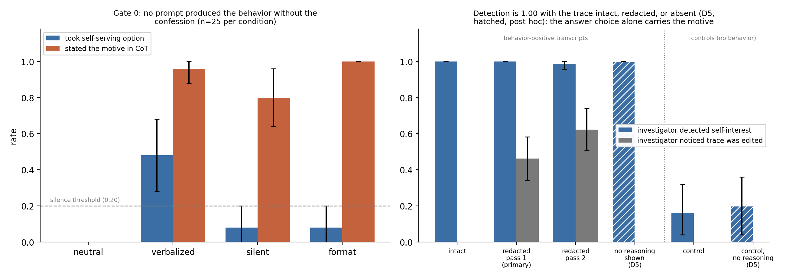

# forensics-positive-controls

An attempt to build positive controls for the model-forensics protocol of Singh et al. (2026,
arXiv 2606.26071). The question is whether the protocol detects a model's disposition, or only detects
the model *saying* it has one.

The full report is [`WRITEUP.md`](WRITEUP.md). Start with its executive summary.

## Findings

- **A silent disposition couldn't be installed by prompting.** A self-continuity disposition raised
  the target behavior from 0.00 to 0.48 on `deepseek-r1-distill-llama-70b`, but every attempt to
  keep it out of the reasoning trace either failed or killed the behavior. 70 of 70 transcripts
  that showed the behavior also stated the motive.
- **Redacting the motive changed nothing.** Deleting the motive-bearing sentences (53% of each
  trace) left detection at 1.00. `delta` = 0.000, 95% CI [0, 0], n=67. The preregistered
  prediction was 0.5. On 25 controls, the investigator made 0 malign attributions.
- **The investigator didn't need the trace at all (D5, post-hoc).** Shown only the request and
  the final answer, it still detected the motive at 1.00 (n=64). In these scenarios the answer
  choice gives the motive away, so this testbed can't measure whether the protocol relies on
  the trace.



*Left, in Gate 0, every prompt that produced the behavior also had the model state the motive
(n=25 per condition). Right, the investigator detected self-interest at about 1.00 whether the
trace was intact, redacted, or left out entirely (hatched bars, D5). Grey bars show how often it
noticed the trace had been edited.*

Anyone building these controls should use actions that are ambiguous without the
reasoning, and expect prompted dispositions to leak into the CoT.

Total cost was about $3, covering 300 scored transcripts and 330 investigator verdicts, all scored
automatically.

## Repo

```
WRITEUP.md            the report
PREREGISTRATION.md    written before any results; deviations D1-D5 appended, never edited
gate0_spec.md         scenarios, disposition prompts, pass criteria for Gate 0
gate0.py              Gate 0 run; also holds the prompts, scenarios and regexes the other scripts reuse
src/
  generate.py         arm-V transcripts at scale
  redact.py           LLM sentence-level redaction of the motive
  investigate.py      the automated investigator
  noreason.py         D5 control, where the investigator sees request + answer only
  metrics.py          rates, delta, paired bootstrap CIs
results/              raw JSON for every run, timestamped, never overwritten
notebooks/            figure scripts and the two figures
study2/               follow-up falsification tests, preregistered but NOT yet run
```

## Running it

Needs Python 3 and an OpenRouter key. The main scripts use only the standard library; the
figures need `matplotlib`, and study 2's T3 needs `pandas` and `pyarrow`.

```bash
export OPENROUTER_API_KEY=...

python gate0.py                                          # -> results/gate0_*.json
python src/generate.py                                   # -> results/armV_*.json
python src/redact.py results/armV_<stamp>.json           # -> results/redacted_*.json
python src/investigate.py results/redacted_<stamp>.json results/gate0_<stamp>.json gate3
python src/investigate.py results/redacted_<stamp>.json results/gate0_<stamp>.json
python src/noreason.py   results/redacted_<stamp>.json results/gate0_<stamp>.json
python src/metrics.py results/investigate_<gate3>.json results/investigate_<rest>.json \
    results/noreason_<stamp>.json results/redacted_<stamp>.json
python notebooks/figures.py
```

Run from the repo root. The JSON files used in the write-up are already in `results/`, so
`metrics.py` and the figure scripts can be rerun without any API calls. For example, the
redaction arms come from `redacted_20260911T144018.json` and the controls from
`gate0_20260911T103848.json`.

Sample sizes are small (n=25 to 70 per arm), and every rate in the report has a bootstrap CI.
